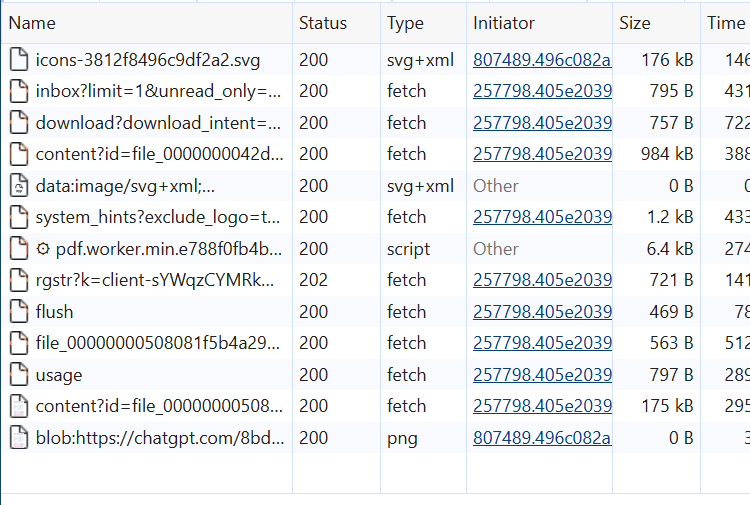
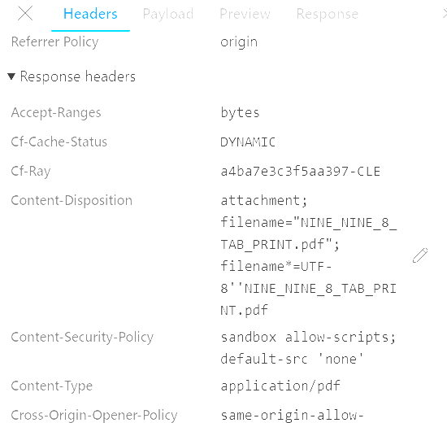

<h1>ChatGPT PDF Viewer Download Investigation</h1>
<h3>BROWSER NETWORK ANALYSIS · TECHNICAL TROUBLESHOOTING CASE STUDY</h3>

<strong>Microsoft Edge · Developer Tools · HTTP · Evidence-Based Diagnosis</strong>

<a href="#executive-overview">Overview</a> ·
<a href="#investigation-method">Method</a> ·
<a href="#verified-observations">Findings</a> ·
<a href="#evidence-and-documentation">Evidence</a> ·
<a href="../../">Portfolio Home</a>

---

## Executive Overview

On **October 16, 2026**, I investigated a reproducible PDF download problem in the ChatGPT web application using **Microsoft Edge on Windows**. The document viewer's download control did not create a visible entry in Edge Downloads, while a direct file link in the conversation successfully downloaded the same generated PDF.

I used browser Developer Tools to compare the observed download-related requests, response metadata, and browser behavior. The investigation identified a discrepancy between successful HTTP responses and the absence of a visible browser download from the viewer control. **The underlying root cause has not been established.**

**Scope:** Troubleshooting my own generated document through ordinary browser diagnostics. No third-party data access, authorization bypass, security exploitation, or vulnerability disclosure was involved.

## Technical Environment

| Component | Details |
|---|---|
| Browser | Microsoft Edge on Windows |
| Application | ChatGPT web application |
| Diagnostic tools | Edge Developer Tools: Network and Console; Edge Downloads |
| File type | PDF (`application/pdf`) |
| Investigation date | October 16, 2026 |
| Current status | Workaround confirmed; investigation ongoing |

## Investigation Method

1. Reproduced the failure using the PDF viewer's download control.
2. Confirmed that a direct Markdown file link within the conversation successfully downloaded the PDF.
3. Opened **Edge Developer Tools → Network**, enabled **Keep log** and **Disable cache**, and repeated the test.
4. Inspected the download-related `download?download_intent=...` request and the returned JSON properties, including `download_url`.
5. Inspected the PDF `content?id=file_...` response, HTTP status, content type, and content-disposition header.
6. Checked **Edge Downloads (Ctrl+J)** for a corresponding item after the viewer-control attempt.
7. Recorded unrelated console messages separately to avoid attributing causation without evidence.

## Verified Observations

| Test or observation | Recorded result |
|---|---|
| Viewer download control | No visible saved download |
| Edge Downloads after viewer action | No corresponding entry |
| Direct conversation file link | Download succeeded |
| Download-related API | HTTP 200; JSON containing `download_url` and file metadata |
| PDF content response | HTTP 200 and `Content-Type: application/pdf` |
| Content-disposition | `attachment` with a matching filename |
| Other console/network warnings | Some HTTP 403 responses and warnings observed; causal connection not proven |

### What the evidence supports

The successful responses indicate that download metadata and PDF content were returned during the observed requests. The working direct-link path demonstrates that the generated file was accessible through at least one download workflow.

### What the evidence does not prove

An HTTP 200 response does **not** prove a file was saved by the browser. The present evidence does not establish whether the failure occurred in frontend download initiation, browser download handling, browser settings or policy, or another component. The unrelated HTTP 403 responses and accessibility/content-security-policy warnings should **not** be presented as the confirmed cause.

**Working hypothesis:** A later stage of the viewer-specific download workflow may have failed. This remains a hypothesis pending additional evidence.

## Confirmed Workaround

A **direct Markdown link to the generated PDF in the conversation** successfully initiated a download in the observed environment. The viewer's download button did not produce the same result in the documented test.

## Evidence and Documentation

The repository contains supporting screenshots and detailed investigation notes. Images should be reviewed for sensitive URLs, identifiers, tokens, and session data before being shared publicly.

[Network request screenshot](evidence/01-network-successful-requests.png) · [Download API JSON screenshot](evidence/02-download-json-metadata.png) · [PDF response headers](evidence/03-pdf-response-headers.png)

| Document | Description |
|---|---|
| [Investigation README](README.md) | Original case study and factual observations |
| [Evidence notes](evidence/README.md) | Evidence inventory and publication precautions |
| [Incident report](incident-report.md) | Documented symptoms, scope, and impact |
| [Root-cause analysis](root-cause-analysis.md) | Competing explanations and diagnostic limits |
| [Lessons learned](lessons-learned.md) | Troubleshooting practices and future improvements |

## Professional Skills Demonstrated

- Reproducing a problem and defining a controlled test scope.
- Inspecting browser Network requests and HTTP response metadata.
- Interpreting `200 OK`, `Content-Type`, `Content-Disposition`, and JSON API responses.
- Comparing working and failing application paths.
- Preserving evidence while distinguishing observations from hypotheses.
- Communicating a workaround without overstating the root cause.

This is an **application troubleshooting case study**, not a confirmed cybersecurity incident, exploit, or security vulnerability.

## Next Investigation Steps

If the issue remains reproducible, compare browser download settings and permissions, inspect viewer-specific client behavior using ordinary debugging tools, and test whether the behavior changes under a controlled browser configuration. Document any additional results before updating the conclusion.

## Responsible AI Use

I performed the browser tests and supplied the observations and screenshots. ChatGPT assisted with structuring, drafting, and editing the technical case study. AI-generated explanations are not treated as independently verified evidence.

---

**James Taylor Jordon** · Cybersecurity &amp; Network Systems · October 2026  
*Evidence first. Conclusions follow the data.*

[Return to Professional Portfolio](../../)

